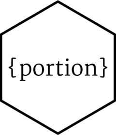

<!-- README.md is generated from README.Rmd. Please edit that file -->

```{r, setup, include = FALSE}
knitr::opts_chunk$set(collapse = TRUE, comment = "#>")
library("portion")
```

# Extracting a Data Portion 

<!-- badges: start -->
[](https://github.com/loelschlaeger/portion/actions/workflows/R-CMD-check.yaml)
[](https://CRAN.R-project.org/package=portion)
[](https://CRAN.R-project.org/package=portion)
[](https://app.codecov.io/gh/loelschlaeger/portion?branch=master)
<!-- badges: end -->

The `{portion}` `R` package offers convenient tools to extract data portions
from common R objects:

1. works for `vector`, `matrix`, `data.frame`, and `list` objects

2. the relative portion size can be selected

3. allows extracting first, last, random, similar, or dissimilar data

4. can portion row- and column-wise

5. provides selected indices as an attribute

6. preserves object attributes

## Installation

You can install the released version from [CRAN](https://CRAN.R-project.org) with:

```{r, install released, eval = FALSE}
install.packages("portion")
```

## Examples

Portion a `vector` by selecting similar or dissimilar values:

```{r, vector example}
set.seed(1)
x <- c(1, 1, 2, 2)
portion(x, proportion = 0.5, how = "similar")
portion(x, proportion = 0.5, how = "dissimilar")
```

Portion a `matrix` row-wise or column-wise:

```{r, matrix example}
x <- matrix(LETTERS[1:24], nrow = 4)
portion(x, proportion = 0.5, how = "first")
portion(x, proportion = 0.5, how = "first", byrow = FALSE)
```

Portion a `data.frame` at random. The selected row or column indices are stored
in the `"indices"` attribute.

```{r, data.frame example}
set.seed(1)
x <- as.data.frame(diag(8))
portion(x, proportion = 0.3, how = "random")
portion(x, proportion = 0.3, how = "random", byrow = FALSE)
```

For clustering data frame rows, all non-ignored columns must be numeric or
logical. Use `ignore` to exclude identifiers, labels, or grouping columns from
the clustering data while keeping them in the returned object.

```{r, data.frame clustering example}
x <- data.frame(value = c(1, 1, 5, 5), group = c("a", "a", "b", "b"))
portion(x, proportion = 0.5, how = "similar", ignore = 2)
```

Portion each element of a `list`:

```{r, list example}
x <- list(1:5, diag(3), data.frame(1:3, 2:4))
portion(x, proportion = 0.5, how = "last")
```
